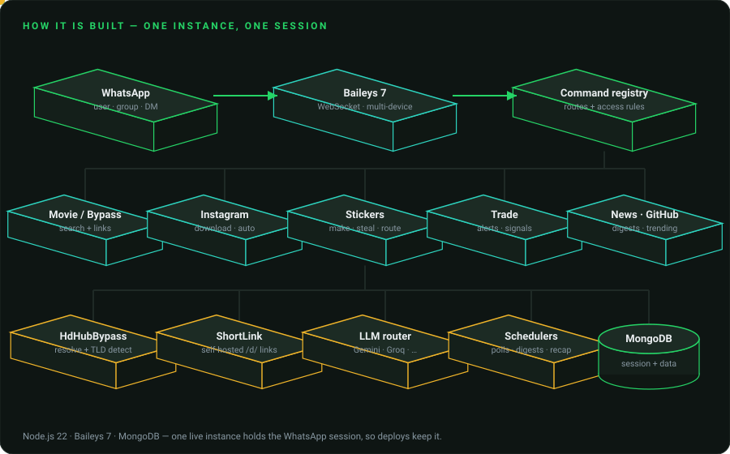
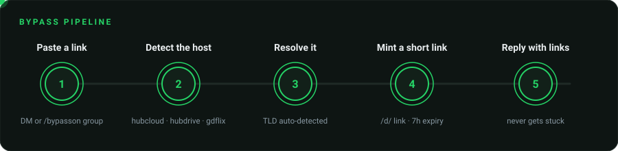
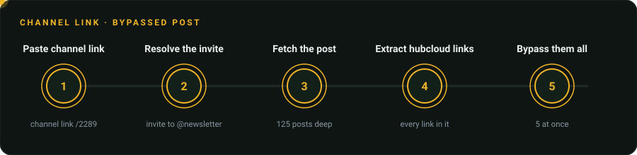
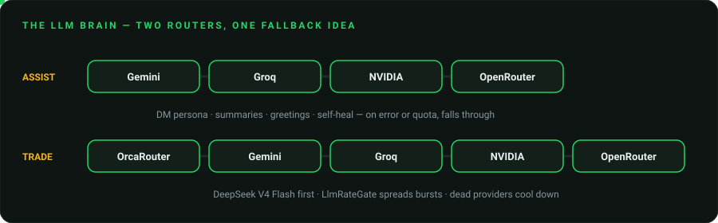
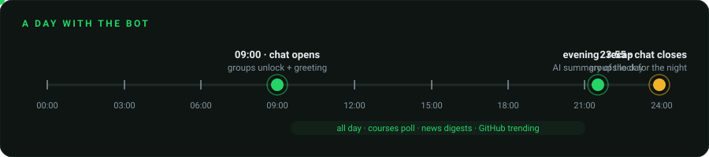

# WA-BOT

[](https://nodejs.org)
[](https://github.com/WhiskeySockets/Baileys)
[](https://www.mongodb.com)
[](LICENSE)
[](https://pronoob-dev.github.io/WA-BOT)

One WhatsApp bot that runs a whole group: movies with working download links, Instagram downloads, stickers, tech news, GitHub trending, trade alerts, and an LLM that answers DMs, writes the daily recap, and heals the bot itself. Built on [Baileys](https://github.com/WhiskeySockets/Baileys) 7, Node.js 22, MongoDB. One live instance holds the WhatsApp session.



**Site:** [pronoob-dev.github.io/WA-BOT](https://pronoob-dev.github.io/WA-BOT) · **Deploy:** [Render](DEPLOY.md) · [Koyeb](DEPLOY_KOYEB.md) (free tier, never sleeps) · **Agent rules:** [AGENTS.md](AGENTS.md)

---

## How it is built



The flow is boring on purpose: WhatsApp → Baileys socket → command registry (routes + access rules) → one controller per area → services that do the work → MongoDB, which also stores the WhatsApp session, so a redeploy keeps the login.

## The bypasser



Paste a hubcloud / hubdrive / gdflix link in a DM and it bypasses itself — no command needed. Groups work the same once a staff member runs `/bypasson`. Or `/bypass <link>` anywhere, up to 5 links at once.

- **Hubcloud TLDs rotate; the bot doesn't care.** Every successful fetch records the live TLD after redirects, and a failed fetch probes the other known TLDs. No more hand-editing links when hubcloud moves.
- **Short links are its own.** Every direct link gets a self-hosted `/d/` link that expires in 7 hours, so a leaked link dies on its own.
- **It can't get stuck.** Progress edits are fire-and-forget, every short-link mint is capped at 8 seconds, and a stalled result edit falls back to a fresh message. A hung edit or a slow database used to freeze the whole bypass; now the run always finishes.



A `whatsapp.com/channel/…/2289` link works the same way: the bot resolves the channel, pages back through its history (up to 125 posts) to find that exact post, and bypasses every hubcloud link inside it. If the post can't be found, it says so instead of staying silent.

Free users get daily limits on movie search and bypasses; premium and staff are unlimited.

## The LLM brain



This is the part most bots don't have: two real fallback routers, not one API key and a prayer.

| Router | Chain | What it powers |
|---|---|---|
| **Assist** | Gemini → Groq → NVIDIA → OpenRouter | `/assist` DM persona, group recaps, auto-chat greetings, `/fix` self-heal |
| **Trade** | OrcaRouter (free DeepSeek V4 Flash) → Gemini → Groq → NVIDIA → OpenRouter | Trade alerts, `/tradenow`, `/swing`, `/expiry` |

On an error or a quota hit, the request falls through to the next provider; a dead provider cools down instead of being retried (one interview-question generation once took 163s retried against a dead provider — that's what the cooldown fixed). Bursts spread across providers through a per-provider rate gate instead of stampeding the first one.

## A day with the bot



## What it does

| Area | What it does |
|------|----------------|
| **Courses** | Polls free courses and posts to activated groups (no duplicates per group) |
| **Movies** | `/movie` search with live progress, daily limits, premium, short links, TMDB upcoming / genre / trending |
| **Bypass** | Auto-bypass in DMs and `/bypasson` groups; channel links; hubcloud TLD auto-detect |
| **Instagram** | Download posts/reels (`/insta`); auto-download in DMs and groups with `/instaon` |
| **Stickers** | Create/steal/convert stickers; auto-forward from WhatsApp channels into target groups |
| **News** | Scheduled Inshorts tech digests (`/newson`) |
| **GitHub** | Scheduled trending repos (`/githubon`) |
| **Group recap** | End-of-day AI summary (`/summaryon`) |
| **Auto chat** | Locks/unlocks group chat daily — opens 9 AM + short LLM greeting from the group title/description, closes 11:55 PM (`/autochat`) |
| **Trade** | NSE F&O alerts (`/tradelert`), on-demand `/tradenow`, `/swing` momentum setups, `/expiry` expiry-day index options, measured win rates via `/tradelert stats` |
| **Fun** | Horoscope, advice, fun facts, RGB stickers |
| **Moderation** | Warns, message delete helpers, welcome messages |
| **Owner** | Premium/mods, member scrape & broadcast, Drive sources, `/assist` DM persona, `/fix` self-heal, `/deploy` |
| **Dashboard** | Web admin panel (`/admin?token=…`) and a live dashboard |

Activation (`/activate`) mentions the bot owner with a tappable WhatsApp @mention (DM link). Asking "who is ur owner" (or similar) replies with owner info.

---

## Quick start

```bash
git clone https://github.com/ProNoob-Dev/WA-BOT.git
cd WA-BOT
npm install
cp .env.example .env   # then edit values
npm start
```

1. Set at least `MONGODB_URI` and `OWNER_NUMBERS` in `.env`.
2. Run `npm start` and scan the QR from the terminal/logs with WhatsApp.
3. Auth is saved in MongoDB — redeploys keep the session if the same DB is used.

**Dev (auto-reload):** `npm run dev`

**Clear WhatsApp auth in MongoDB** (forces a fresh QR): `npm run clear-auth`

**Checks (offline self-checks):** `npm test`

---

## Configuration

Copy [`.env.example`](.env.example) → `.env`. Important variables:

| Variable | Purpose |
|----------|---------|
| `MONGODB_URI` / `MONGODB_DB_NAME` | Required — data + WA session |
| `OWNER_NUMBERS` | Owner phones/LIDs (comma-separated, country code, no `+`) |
| `MODERATOR_NUMBERS` | Can activate/deactivate groups |
| `BOT_LOG_NUMBER` | Startup + movie search logs |
| `CHECK_INTERVAL` | Course poll interval (seconds, default `180`) |
| `NEWS_POST_TIMES` / `NEWS_TIMEZONE` | Tech news schedule |
| `GITHUB_TRENDING_*` | GitHub digest schedule |
| `STICKER_TARGET_GROUPS` / `STICKER_SOURCE_CHANNELS` | Sticker routing |
| `TMDB_API_KEY` | Upcoming / genre / trending movies |
| `GEMINI_API_KEY` / `GROQ_API_KEY` / `NVIDIA_API_KEY` / `OPENROUTER_API_KEY` | LLM features (trade, summary, assist, heal) |
| `ASSIST_OWNER_NAME` / `ASSIST_OWNER_ABOUT` | DM assist persona + bio |
| `ADMIN_TOKEN` | Web admin panel (`/admin?token=…`) |
| `PUBLIC_URL` | Optional custom domain for movie short links (auto on Render/Koyeb) |

Full list and comments: **`.env.example`**. Deploy notes: **[DEPLOY.md](DEPLOY.md)** (Render) / **[DEPLOY_KOYEB.md](DEPLOY_KOYEB.md)** (Koyeb — free tier, never sleeps) / **[QUICKSTART_RENDER.md](QUICKSTART_RENDER.md)**.

---

## Roles

1. **Owners** (`.env` `OWNER_NUMBERS`) — full control
2. **Moderators** (env + `/addmod`) — activate groups, feature toggles
3. **Bot admins** (`/addadmin`) — staff tools
4. **WhatsApp group admins** — auto-detected in that group
5. **Anyone** — public commands (`/movie`, `/insta`, `/help`, …)

Exact checks live in `src/commands/registry.js` + `src/commands/access.js`. In-chat: `/help`.

---

## Commands (summary)

Use `/help` on WhatsApp for the live list filtered by your role and chat type.

### Anyone
`/ping` · `/help` · `/movie` · `/upcoming` · `/genre` · `/insta` · `/sticker` · `/steal` · `/toimg` · `/rgb` · `/horo` · `/advice` · `/facts` · `/news` · `/github` · `/posted` · `/status` · `/checklimit`

### Bypass
`/bypass` · `/bypasson` · `/bypassoff`

### Admin trading (groups only)
`/tradenow` · `/swing` · `/expiry`

### Staff (group toggles)
`/activate` · `/deactivate` · `/courson` · `/coursesoff` · `/newson` · `/newsoff` · `/githubon` · `/githuboff` · `/autochat` · `/instaon` · `/instaoff` · `/stickeron` · `/stickeroff` · `/movieon` · `/movieoff` · `/summaryon` · `/summaryoff` · `/summarynow` · `/trending` · `/tradelert`

### Admins / moderation
`/setwc` · `/warn` · `/warns` · `/mywarns` · `/clearwarns` · `/dellast` · `/delall` · `/groups` · `/pause` · `/resume` · `/clear` · `/confirm` · `/cancel` · `/addadmin` · `/removeadmin` · `/admins` · `/increaselimit`

### Owner
`/addpremium` · `/removepremium` · `/premium` · `/addmod` · `/removemod` · `/assist` · `/fix` · `/heal` · `/addchannel` · `/removechannel` · `/channels` · `/scrap` · `/scrapmembers` · `/broadcast` · `/grouppost` · `/driveurl` · `/deploy`

---

## Typical group setup

1. Add the bot to the group (promote to admin if you need deletes/warns/kicks).
2. `/activate` — turns on default group features and shows owner @mention.
3. Optionally toggle: `/movieon`, `/newson`, `/githubon`, `/instaon`, `/summaryon`, `/autochat on`, `/tradelert on`, `/setwc on …`.

---

## Project layout

```
WA-BOT/
├── bot-new.js                 # Entry point
├── src/
│   ├── commands/              # Registry + access rules
│   ├── config/                # Env → config
│   ├── controllers/           # Commands (movie, trade, stickers, …)
│   │   └── handlers/          # Split command handlers
│   ├── dashboard/             # Web admin panel
│   ├── db/                    # Mongo connection
│   ├── models/                # Persistence (groups, auth, warns, …)
│   ├── prompts/               # LLM system prompts
│   ├── services/              # WA, scrapers, LLM routers, APIs
│   └── utils/                 # Messaging, schedulers, permissions
├── docs/                      # GitHub Pages site + diagrams
├── scripts/                   # Helpers (clear-auth, offline checks, …)
├── .env.example
├── DEPLOY.md
└── package.json
```

---

## Scripts

| Command | Description |
|---------|-------------|
| `npm start` | Run bot (`bot-new.js`, 450MB heap) |
| `npm run dev` | Watch mode |
| `npm run clear-auth` | Wipe WhatsApp auth in MongoDB |
| `npm test` | Offline self-checks (`scripts/check-*.js`) |

---

## Notes

- One live instance should hold the WhatsApp session (see instance lock in code) to avoid conflict logouts.
- Movie search shows an in-chat progress bar, then deletes the loader before sending results.
- Agent coding conventions for this repo: **[AGENTS.md](AGENTS.md)** (Ponytail / lazy-senior rules).
- Diagrams in this README are generated from `docs/assets/build-*.py` — edit the script, not the SVG.

## License

ISC
